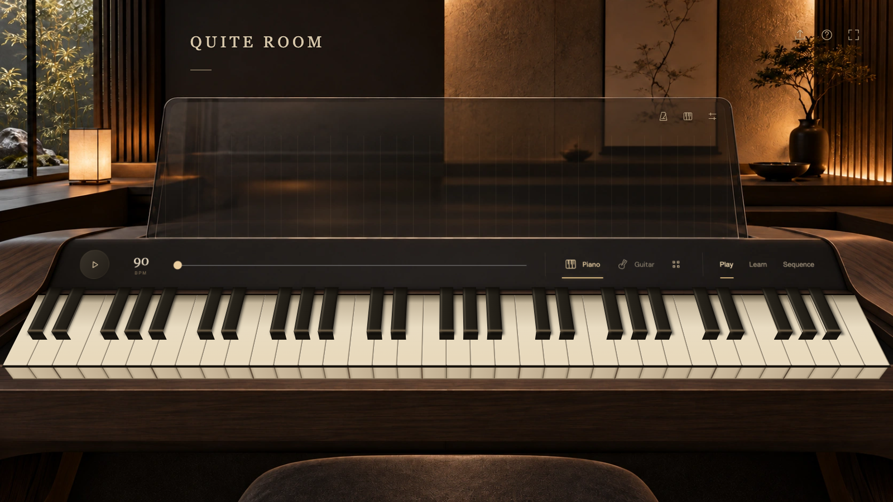
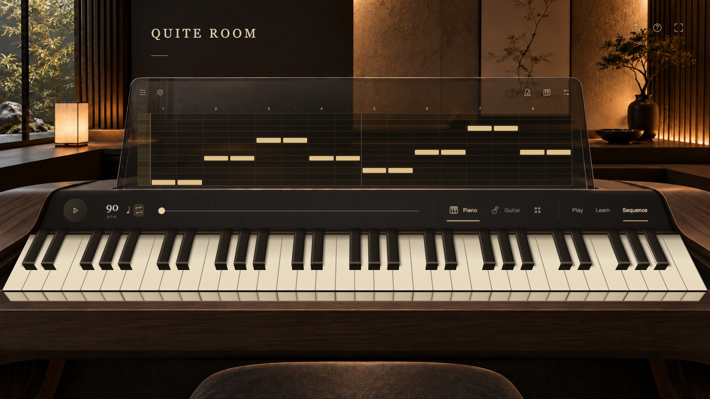
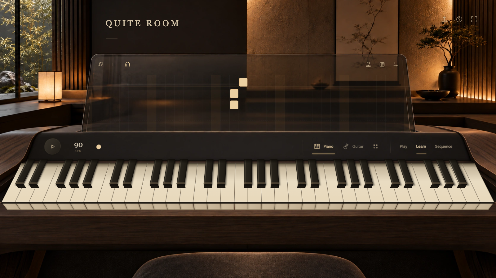

<div align="center">

# Quite Room

**A little room for your next musical idea.**

Play a melody, build a loop, or learn a song at your own pace.<br>
A browser music studio with eight instruments, a perspective keyboard, and warm glass controls.

[](https://pouyanjay.github.io/quiteroom/)
[](LICENSE)

[**Open Quite Room →**](https://pouyanjay.github.io/quiteroom/)

[The experience](#the-experience) · [Play](#play) · [Sequence](#sequence) · [Learn](#learn) · [Get started](#get-started)



<sub>Play, compose, and practice in one quiet space.</sub>

</div>

## The experience

Quite Room makes space for small musical moments: finding a chord you like, sketching a phrase, or finally getting a melody under your fingers. Open the studio and start at the keyboard. Switch between playing, composing, and practicing as the idea takes shape.

The room is part of the experience. Soft light, a dimensional keyboard, and controls on the glass keep the instrument at the center. Use your computer keyboard, touch the keys, or connect a MIDI keyboard.

## Play

**Find a sound. Follow it somewhere.**

Start with a warm piano, then explore guitar, electric keys, analog pad, bass, glass bells, organ, and soft strings. Shape the sound with tone and space controls, hold a chord with sustain, and watch the visualization respond as you play.

- Play directly on the keyboard with a mouse or touch, or use your computer keys.
- Shift the keyboard's range and toggle note names as you get comfortable.
- Connect a MIDI keyboard for a more familiar playing experience, where your browser supports it.

## Sequence

**Turn a passing idea into a loop.**

Write notes into the grid or record a phrase into the selected track. Layer three instruments across a two-bar loop, adjust the tempo, and mute parts to hear how they fit together. Undo an edit when you want to try another direction, then export your sequence as MIDI to keep working on it elsewhere.



Your sequence is saved in the current browser. Export a MIDI file to keep a separate copy or move an idea to another device.

## Learn

**Take it one note at a time.**

Choose a built-in melody, practice your own sequence, or import a MIDI file. Falling notes guide you toward the keys. Listen first, slow the piece down, or turn on **Wait for me** to pause until you play the right notes.



Start with *Ode to Joy*, *Twinkle, Twinkle*, or a C major warm-up. When you're ready, bring your own music: MIDI preserves notes, chords, and timing. Audio import also offers experimental melody detection for a clean solo instrument or hummed tune; it processes the first 60 seconds and is not reliable for full songs with chords or drums.

## Your first minute

1. **[Open the studio](https://pouyanjay.github.io/quiteroom/)** and play a few notes with the piano.
2. **Choose another sound** and adjust tone or space to make it yours.
3. **Open Sequence** to sketch a loop, or **Learn** to follow a melody.

| Control | Action |
| --- | --- |
| Computer keyboard | Use A–L and W–P; see Keyboard settings for guidance |
| Shift | Hold sustain |
| Space | Play or pause the transport |
| Connect keyboard | Connect a MIDI instrument in a supported browser |

Sound starts after you interact with the studio. MIDI hardware access depends on your browser and permissions. Saved sequences stay in this browser and do not sync between devices.

## Get started

**[Play Quite Room in your browser](https://pouyanjay.github.io/quiteroom/)**. The live studio is hosted on GitHub Pages. No installation or API key is needed.

### Run locally

To run your own copy, clone the repository and serve the app:

```sh
git clone https://github.com/PouyanJay/quiteroom.git
cd quiteroom
python3 -m http.server 8000 --directory dist
```

Open [localhost:8000](http://localhost:8000). Serve the app over HTTP so the bundled guitar samples can load.

<details>
<summary>For contributors</summary>

All application source lives in `dist/` and is edited directly. Every push to `main` deploys `dist/` to [GitHub Pages](https://pouyanjay.github.io/quiteroom/) through the [deployment workflow](.github/workflows/pages.yml). You can also run the workflow manually from the repository's Actions tab.

For the existing logic checks, use Node.js 22 or later:

```sh
npm install
npm test
```

These tests cover application logic with mocked browser and audio APIs. Check rendering, keyboard interaction, and sound in a real browser when changing the experience. Preserve the warm glass styling and Play mode default, and update asset version query strings in `dist/index.html` when changing browser assets.

</details>

## Credits & license

Quite Room is released under the [MIT License](LICENSE).

The guitar uses bundled FluidR3 steel-string samples by Frank Wen and contributors, packaged by MIDI.js Soundfonts under **CC BY 3.0**. See [guitar credits](dist/assets/GUITAR-CREDITS.txt) for attribution and source links. The other instruments use browser audio synthesis.
